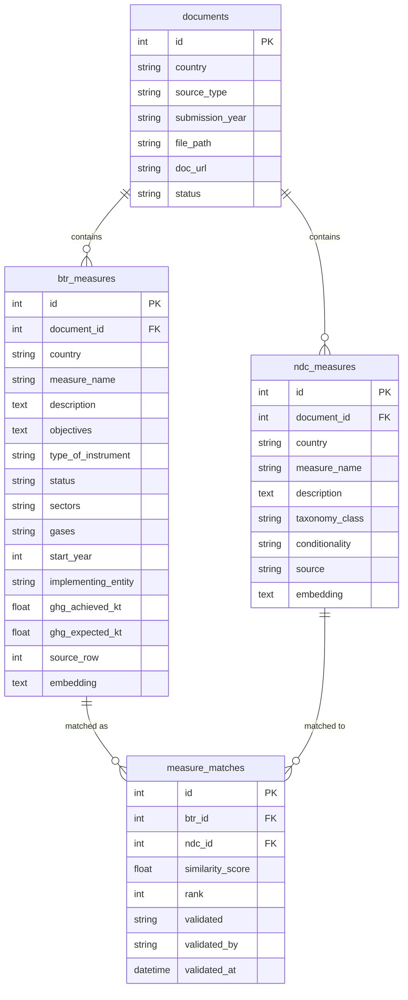

# BTR Transport Analysis Pipeline

A Python-based pipeline that extracts transport-relevant climate policy measures from Biennial Transparency Reports (BTRs), stores them alongside existing NDC measures, and uses semantic similarity to identify matching commitments across both document types.

Developed as an extension of the [NDC Transport Tracker](https://changing-transport.org/tracker/), a joint initiative by GIZ and the Partnership on Sustainable, Low Carbon Transport (SLOCAT).

## Background

Countries submitting BTRs to the UNFCCC under the Enhanced Transparency Framework include a standardised CTF-NDC Table 5 listing mitigation policies and measures. This pipeline extracts transport-relevant entries from those tables and matches them against existing NDC measures to track policy continuity over time.

## Pipeline Overview

The analysis runs in three sequential steps:

1. `survey_headers.py` — scans all downloaded BTR Excel files and maps column name variants across countries. Output is `header_survey.csv`, which documents header variance and was used to design the normalization logic in the extractor.
2. `extract_btr_measures.py` — reads Table 5 from each file, identifies transport-relevant rows, normalises column names using keyword-based fuzzy matching, and writes structured measure records to a SQLite database.
3. `embed_and_match.py` — generates text embeddings for BTR and NDC measures using Azure OpenAI, then runs cosine similarity matching per country to find candidate pairs for analyst review.

## Database Schema

The pipeline uses a SQLite database (`btr_analysis.db`) with three tables.



### Table notes
* `documents` — shared parent for both measure types. `source_type` is `'BTR'` or `'NDC'` (extensible to `'LTS'`).
* `btr_measures` — one row per transport measure extracted from a CTF-NDC Table 5. `source_file` is the originating `.xlsx` filename; `source_row` is the 0-based row index within the Table 5 sheet. `embedding` stores a JSON-serialised float list, populated by `embed_and_match.py`.
* `ndc_measures` — NDC measures imported from the existing Excel export. Same embedding format. `source` is `'excel_export'`.
* `measure_matches` — output of the semantic matching step. Stores the top-3 candidate NDC matches per BTR measure (`rank` 1–3). `validated` is `NULL` until an analyst reviews the pair, then `'confirmed'` or `'rejected'`.

## Requirements

```
python >= 3.10
openpyxl
pandas
numpy
openai
playwright
requests
```

Azure OpenAI credentials are expected as environment variables:

```
AZURE_OPENAI_ENDPOINT
AZURE_OPENAI_API_KEY
AZURE_OPENAI_API_VERSION
```

The embedding model used is `text-embedding-3-small`. Classification uses `gpt-4`.

## Usage

```bash
# Step 1: survey column headers across all downloaded files
python survey_headers.py

# Step 2: extract transport measures into the database
python extract_btr_measures.py

# Step 3: embed measures and run semantic matching
python embed_and_match.py
```

BTR Excel files are expected in `downloaded_xlsx/`. The scraping and download step is handled separately by `brt_transport_analysis.py`.

## Project Structure

```
.
├── brt_transport_analysis.py   # Scrapes UNFCCC and downloads BTR Excel files
├── survey_headers.py           # Maps column name variants across all files → header_survey.csv
├── extract_btr_measures.py     # Extracts and normalises Table 5 transport measures
├── embed_and_match.py          # Generates embeddings and runs semantic matching
├── btr_analysis.db             # SQLite database (generated)
├── header_survey.csv           # Column name survey output (generated)
├── downloaded_xlsx/            # Cached BTR Excel files (generated)
└── README.md
```

## Deployment

The pipeline currently runs manually. It is designed to be integrated into the existing NDC Transport Tracker container app hosted on Azure. Future versions may trigger automatically when new BTR documents are published on the UNFCCC registry.

## Related Resources

* [NDC Transport Tracker](https://changing-transport.org/tracker/)
* [Transport Data Commons (open data)](https://portal.transport-data.org/@giz/gizslocat-transport-climate-tracker)
* [UNFCCC First Biennial Transparency Reports](https://unfccc.int/first-biennial-transparency-reports)
