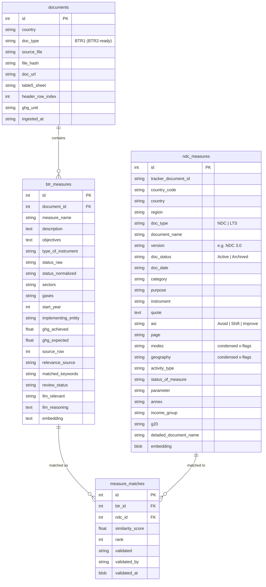

# BTR Transport Analysis Pipeline

A Python-based pipeline that extracts transport-relevant climate policy measures from Biennial Transparency Reports (BTRs), stores them in a reviewable database, and is designed to match them against existing NDC measures via semantic similarity (matching step deferred until the NDC import is available).

Developed as an extension of the [NDC Transport Tracker](https://changing-transport.org/tracker/), a joint initiative by GIZ and the Partnership on Sustainable, Low Carbon Transport (SLOCAT). Designed to be complementary to the [climate-policy-miner](https://transport-policy-miner.greendesert-33ef5f35.germanywestcentral.azurecontainerapps.io/) app: the review interface will be integrated there, and the LLM steps use the same Azure OpenAI environment variables.

## Background

Countries submitting BTRs to the UNFCCC under the Enhanced Transparency Framework include a standardised CTF-NDC Table 5 listing mitigation policies and measures. This pipeline extracts transport-relevant entries from those tables (both measures classified under the transport sector and measures filed under other sectors (mostly energy) whose content affects transport).

## Pipeline Overview

The core is the `btr_pipeline` package with a single CLI entry point:

```bash
# One-time batch extraction of all cached BTR files
python pipeline.py batch

# Reproducible single-document ingestion (e.g. when a new BTR is published)
python pipeline.py ingest --file data/downloaded_xlsx/Chile.xlsx [--country Chile] [--doc-type BTR1] [--url ...]

# Import NDC/LTS measures from the GIZ-SLOCAT Tracker database export
python pipeline.py import-ndc [--file ndc_tracker_database.xlsx]

# Embed measures + semantic matching BTR -> NDC (requires Azure OpenAI credentials in .env)
python pipeline.py embed
python pipeline.py match

# LLM confirmation of content-matched measures (requires Azure OpenAI credentials)
python pipeline.py classify

# Export all tables to a browsable Excel workbook
python pipeline.py export [--out btr_analysis_export.xlsx]

# Database summary
python pipeline.py stats
```

Both `batch` and `ingest` are idempotent: each document's measures are replaced on re-ingestion, keyed on (country, doc_type).

### Relevance screening

Each Table 5 row is stored with a `relevance_source`:

| Value | Meaning | `review_status` |
|---|---|---|
| `sector_label` | Sector column contains a transport keyword (multilingual) | `auto` |
| `content_match` | Filed under another sector, but name/description/objectives mention transport (word-boundary keyword matching) | `pending` |
| `sector_specific_file` | The whole submission is transport-specific (e.g. Lao PDR) | `auto` |

`pending` measures are candidates for review: `pipeline.py classify` adds an LLM verdict (`llm_relevant` + `llm_reasoning`) via Azure OpenAI; final confirmation/rejection is an analyst action in the review interface (planned as a page in the climate-policy-miner app), which sets `review_status` to `confirmed` or `rejected`.

### Normalisation

* `status_normalized` maps free-text statuses (multilingual) to `planned` / `adopted` / `implemented` / `expired`; the raw value is kept in `status_raw`.
* `documents.ghg_unit` records the detected GHG reporting unit (`kt CO2 eq` / `Mt CO2 eq`) per document; `ghg_achieved` / `ghg_expected` store raw floats in that unit.

### NDC import

`import-ndc` loads the **Mitigation** sheet of the [GIZ-SLOCAT Tracker database as hosted on TDC](https://portal.transport-data.org/@giz/gizslocat-transport-climate-tracker) into `ndc_measures`: document metadata (type, generation/version, status, date), taxonomy (Category / Purpose / Instrument / Parameter, A-S-I), the quote text with page number, and the per-mode / per-geography `x`-flag columns condensed into comma-separated lists (`modes`, `geography`). Re-running replaces the table content.

### Embedding & semantic matching

`embed` generates one vector per measure via the Azure OpenAI embedding deployment and stores it as a float32 BLOB in the `embedding` column. The embedded text is a `" | "`-joined concatenation of:

| Side | Scope | Columns embedded |
|---|---|---|
| `btr_measures` | `review_status` in (`auto`, `confirmed`) | `measure_name` + `description` + `objectives` |
| `ndc_measures` | all rows (Active and Archived) | `quote` + `purpose` + `instrument` + `category` |

__Rationale__: on the BTR side those three fields carry all the descriptive text. On the NDC side the quote is often very short ("alternative fuels"), so appending the taxonomy labels (purpose, instrument, category) gives the vector enough context to be discriminative.

`match` computes cosine similarity (dot product on unit-norm vectors) between each embedded BTR measure and the NDC/LTS measures of the **same country**, writing the top-3 candidates per BTR measure to `measure_matches` (rank 1–3). **All NDC generations (Active and Archived) are candidates by default** — BTR measures often date back years and may only appear in earlier climate strategies; use `--active-only` to restrict to Active documents. **EU member states fall back to the joint EU NDC** when the Tracker has no national entry. Analyst validations are preserved across `match` re-runs (re-attached by `(btr_id, ndc_id)`).

**Country naming**: the Tracker database is the naming authority. BTR filenames are translated to Tracker naming at ingestion (`btr_pipeline/countries.py`, e.g. Czechia → Czech Republic, Holy See → Vatican), so `documents.country` always joins directly with `ndc_measures.country`.

### Excel export

`export` writes `btr_analysis_export.xlsx` with one tab per table (Documents, BTR measures, NDC measures, Matches; embedding BLOBs excluded). The **Matches** tab is enriched: each row carries the full text of both sides (BTR name/description/objectives/status vs. NDC quote/purpose/instrument/category, plus document generation and A-S-I), so matches can be compared and validated directly in Excel.

Note on scores: with an `ada-002`-family deployment, cosine scores compress into roughly 0.7–1.0 — treat them as a ranking signal, not a percentage.

## Database Schema

SQLite (`btr_analysis.db`), all SQL confined to `btr_pipeline/db.py` with portable column types so migration to Azure PostgreSQL is a single-module port.



* `documents` — one row per ingested source document, unique on (country, doc_type). Ready for BTR2 versioning.
* `btr_measures` — one row per in-scope measure; `ON DELETE CASCADE` from documents makes single-document re-ingestion clean.
* `measures_view` — flat view joining measures with document metadata, intended as the read surface for the review UI and analysis notebooks.
* `ndc_measures` — mirror of the Tracker export's Mitigation sheet (see *NDC import* above).
* `measure_matches` — top-3 NDC candidates per BTR measure; `validated` / `validated_by` / `validated_at` are written by analysts during review.

## Requirements

```
python >= 3.10
openpyxl
playwright + requests   (scraping/download step only)
openai                  (classify step only)
```

Azure OpenAI credentials for `embed` / `match` / `classify`, read from a local `.env` file (gitignored) or the environment:

```
AZURE_OPENAI_ENDPOINT
AZURE_OPENAI_API_KEY
AZURE_OPENAI_API_VERSION
AZURE_OPENAI_CHAT_DEPLOYMENT_NAME        # classify
AZURE_OPENAI_EMBEDDING_DEPLOYMENT_NAME   # embed
```

## Project Structure

```
.
├── pipeline.py                   # CLI: batch / ingest / import-ndc / embed / match / classify / export / stats
├── btr_pipeline/
│   ├── db.py                     # schema + data access (portable to PostgreSQL)
│   ├── extract.py                # Table 5 parsing, relevance screening, normalisation
│   ├── countries.py              # canonical Tracker country naming
│   ├── ndc_import.py             # Tracker Mitigation sheet -> ndc_measures
│   ├── match.py                  # embeddings + semantic matching BTR -> NDC
│   └── export.py                 # database -> Excel workbook
├── brt_transport_analysis.py     # Scrapes UNFCCC and downloads BTR Excel files
├── data/
│   ├── btr_analysis.db           # SQLite database
│   ├── downloaded_xlsx/          # Cached BTR Excel files
│   └── btr_transport_results.xlsx  # Screening output (source of document URLs)
├── ndc_tracker_database.xlsx     # Tracker export from TDC (gitignored, re-downloadable)
├── btr_analysis_export.xlsx      # Excel export (gitignored, regenerable)
├── .env                          # Azure OpenAI credentials (gitignored)
└── README.md
```

## Current State (2026-07)

* 113 cached CTF-NDC files, 112 ingested (Andorra submitted no Table 5)
* 2,070 BTR measures from 108 countries:
  * 1,226 `sector_label` + 5 `sector_specific_file` (auto-accepted)
  * 839 `content_match` (pending review / LLM confirmation)
* 3,973 NDC/LTS measures imported from the Tracker (183 countries)
* Embeddings generated for all auto-accepted BTR and Active NDC measures
* 1,208 BTR measures matched with top-3 NDC candidates across all NDC generations (3,593 match rows)
  * EU-NDC fallback used for: Bulgaria, Croatia, Estonia, Greece, Italy, Poland, Romania
  * No NDC candidates: Guyana, Philippines (not in Tracker)

## Next Steps

1. **Pilot review** of matches for ~5 countries via the analyst review app (standalone Flask app, blueprint-ready for later integration into the climate-policy-miner).
2. **LLM confirmation** of the 839 pending content-match measures (`pipeline.py classify`).
3. **Azure hosting**: migrate SQLite → Azure PostgreSQL Flexible Server, deploy the review app next to the climate-policy-miner.
4. **Taxonomy classification** (A-S-I) reusing `classification_utils.py` from the climate-policy-miner for NDC-comparable categories.

## Related Resources

* [NDC Transport Tracker](https://changing-transport.org/tracker/)
* [Transport Data Commons (open data)](https://portal.transport-data.org/@giz/gizslocat-transport-climate-tracker)
* [UNFCCC First Biennial Transparency Reports](https://unfccc.int/first-biennial-transparency-reports)
