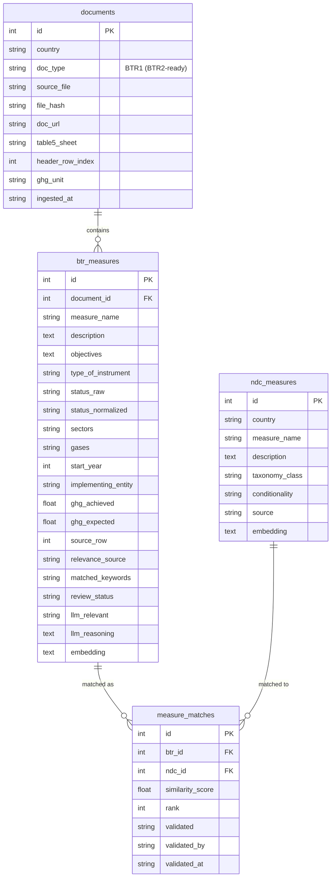

# BTR Transport Analysis Pipeline

A Python-based pipeline that extracts transport-relevant climate policy measures from Biennial Transparency Reports (BTRs), stores them in a reviewable database, and is designed to match them against existing NDC measures via semantic similarity (matching step deferred until the NDC import is available).

Developed as an extension of the [NDC Transport Tracker](https://changing-transport.org/tracker/), a joint initiative by GIZ and the Partnership on Sustainable, Low Carbon Transport (SLOCAT). Designed to be complementary to the [climate-policy-miner](https://transport-policy-miner.greendesert-33ef5f35.germanywestcentral.azurecontainerapps.io/) app: the review interface will be integrated there, and the LLM steps use the same Azure OpenAI environment variables.

## Background

Countries submitting BTRs to the UNFCCC under the Enhanced Transparency Framework include a standardised CTF-NDC Table 5 listing mitigation policies and measures. This pipeline extracts transport-relevant entries from those tables (both measures classified under the transport sector and measures filed under other sectors (mostly energy) whose content affects transport).

## Pipeline Overview

The core is the `btr_pipeline` package with a single CLI entry point:

```bash
# One-time batch extraction of all cached BTR files
python pipeline.py batch

# Reproducible single-document ingestion (e.g. when a new BTR is published)
python pipeline.py ingest --file downloaded_xlsx/Chile.xlsx [--country Chile] [--doc-type BTR1] [--url ...]

# LLM confirmation of content-matched measures (requires Azure OpenAI credentials)
python pipeline.py classify

# Database summary
python pipeline.py stats
```

Both `batch` and `ingest` are idempotent: each document's measures are replaced on re-ingestion, keyed on (country, doc_type).

### Relevance screening

Each Table 5 row is stored with a `relevance_source`:

| Value | Meaning | `review_status` |
|---|---|---|
| `sector_label` | Sector column contains a transport keyword (multilingual) | `auto` |
| `content_match` | Filed under another sector, but name/description/objectives mention transport (word-boundary keyword matching) | `pending` |
| `sector_specific_file` | The whole submission is transport-specific (e.g. Lao PDR) | `auto` |

`pending` measures are candidates for review: `pipeline.py classify` adds an LLM verdict (`llm_relevant` + `llm_reasoning`) via Azure OpenAI; final confirmation/rejection is an analyst action in the review interface (planned as a page in the climate-policy-miner app), which sets `review_status` to `confirmed` or `rejected`.

### Normalisation

* `status_normalized` maps free-text statuses (multilingual) to `planned` / `adopted` / `implemented` / `expired`; the raw value is kept in `status_raw`.
* `documents.ghg_unit` records the detected GHG reporting unit (`kt CO2 eq` / `Mt CO2 eq`) per document; `ghg_achieved` / `ghg_expected` store raw floats in that unit.

## Database Schema

SQLite (`btr_analysis.db`), all SQL confined to `btr_pipeline/db.py` with portable column types so migration to Azure PostgreSQL is a single-module port.



* `documents` — one row per ingested source document, unique on (country, doc_type). Ready for BTR2 versioning.
* `btr_measures` — one row per in-scope measure; `ON DELETE CASCADE` from documents makes single-document re-ingestion clean.
* `measures_view` — flat view joining measures with document metadata, intended as the read surface for the review UI and analysis notebooks.
* `ndc_measures` / `measure_matches` — reserved for the deferred NDC import and semantic matching steps.

## Requirements

```
python >= 3.10
openpyxl
playwright + requests   (scraping/download step only)
openai                  (classify step only)
```

Azure OpenAI credentials for `classify`:

```
AZURE_OPENAI_ENDPOINT
AZURE_OPENAI_API_KEY
AZURE_OPENAI_API_VERSION
AZURE_OPENAI_CHAT_DEPLOYMENT_NAME
```

## Project Structure

```
.
├── pipeline.py                   # CLI: batch / ingest / classify / stats
├── btr_pipeline/
│   ├── db.py                     # schema + data access (portable to PostgreSQL)
│   └── extract.py                # Table 5 parsing, relevance screening, normalisation
├── brt_transport_analysis.py     # Scrapes UNFCCC and downloads BTR Excel files
├── btr_analysis.db               # SQLite database (generated)
├── downloaded_xlsx/              # Cached BTR Excel files (generated)
│
│  # Legacy / exploratory scripts (superseded by btr_pipeline):
├── survey_headers.py             # Column-name variance survey → header_survey.csv
├── extract_btr_measures.py       # First extraction prototype (flat schema)
├── brt_energy_transport_check.py # First energy-sector keyword screen
├── inspect_headers.py            # Ad-hoc sheet structure inspection
└── README.md
```

## Current State (batch of 2026-07)

* 113 cached CTF-NDC files, 112 ingested (Andorra submitted no Table 5)
* 2,070 measures from 108 countries:
  * 1,226 `sector_label` + 5 `sector_specific_file` (auto-accepted)
  * 839 `content_match` (pending review / LLM confirmation)

## Next Steps

1. **LLM confirmation** of the 839 pending content-match measures (`pipeline.py classify`, needs Azure OpenAI credentials).
2. **Review interface** as a page in the climate-policy-miner Flask app, reading `measures_view` and writing `review_status` / `validated` fields.
3. **NDC import + semantic matching** once the Tracker measure export is available (`ndc_measures`, `measure_matches`, embeddings).
4. **Taxonomy classification** (A-S-I) reusing `classification_utils.py` from the climate-policy-miner for NDC-comparable categories.

## Related Resources

* [NDC Transport Tracker](https://changing-transport.org/tracker/)
* [Transport Data Commons (open data)](https://portal.transport-data.org/@giz/gizslocat-transport-climate-tracker)
* [UNFCCC First Biennial Transparency Reports](https://unfccc.int/first-biennial-transparency-reports)
