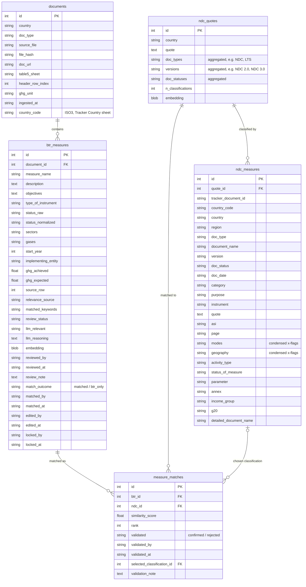

# BTR Transport Analysis Pipeline

A Python-based pipeline that extracts transport-relevant climate policy measures from Biennial Transparency Reports (BTRs), matches them against the NDC commitments in the GIZ-SLOCAT Tracker via semantic similarity, and ships a web app in which analysts validate the results.

Developed as an extension of the [NDC Transport Tracker](https://changing-transport.org/tracker/), a joint initiative by GIZ and the Partnership on Sustainable, Low Carbon Transport (SLOCAT). Designed to be complementary to the [climate-policy-miner](https://transport-policy-miner.greendesert-33ef5f35.germanywestcentral.azurecontainerapps.io/) app: the review app is a Flask blueprint that can be mounted there, and the LLM steps use the same Azure OpenAI environment variables.

## Try the review app

The repository ships with the populated database, so no pipeline run or API key
is needed to look at the data.

```bash
git clone https://github.com/Changing-Transport/btr-analysis.git
cd btr-analysis
python -m venv .venv
```

Activate the environment — `\.venv\Scripts\activate` (Windows PowerShell) or
`source .venv/bin/activate` (macOS/Linux) — then:

```bash
pip install flask
python run_review_app.py
```

Open <http://127.0.0.1:5000>, enter your initials, and start with **2 · Matching**.
See [review_app/README.md](review_app/README.md) for what each stage does, and
[TESTING.md](TESTING.md) for a guided walk-through aimed at reviewers.

> On first run the app seeds a private working copy,
> `data/btr_analysis.local.db`, from the tracked snapshot `data/btr_analysis.db`
> and writes decisions there. The working copy is git-ignored, so pulling or
> switching branches cannot overwrite review work — but it also means decisions
> stay on one machine. Until the hosted deployment is available (see
> *Next Steps*), reviewers share their work through decision files; see
> [SHARING_DECISIONS.md](SHARING_DECISIONS.md). Use `--db data/btr_analysis.db` to work on the tracked snapshot
> deliberately, e.g. to commit a round of review.

## Background

Countries submitting BTRs to the UNFCCC under the Enhanced Transparency Framework include a standardised CTF-NDC Table 5 listing mitigation policies and measures. This pipeline extracts transport-relevant entries from those tables (both measures classified under the transport sector and measures filed under other sectors (mostly energy) whose content affects transport).

## Pipeline Overview

The core is the `btr_pipeline` package with a single CLI entry point:

```bash
# One-time batch extraction of all cached BTR files
python pipeline.py batch

# Reproducible single-document ingestion (e.g. when a new BTR is published)
python pipeline.py ingest --file data/downloaded_xlsx/Chile.xlsx [--country Chile] [--doc-type BTR1] [--url ...]

# Import NDC/LTS measures from the GIZ-SLOCAT Tracker database export
python pipeline.py import-ndc [--file ndc_tracker_database.xlsx]

# Embed measures + semantic matching BTR -> NDC (requires Azure OpenAI credentials in .env)
python pipeline.py embed
python pipeline.py match                  # full re-run: recomputes all candidates
python pipeline.py match --missing-only   # incremental: only measures without candidates

# LLM confirmation of content-matched measures (requires Azure OpenAI credentials)
python pipeline.py classify

# Export all tables to a browsable Excel workbook
python pipeline.py export [--out btr_analysis_export.xlsx]

# Database summary
python pipeline.py stats

# PostgreSQL (hosted database, see deploy/AZURE.md)
python pipeline.py --db postgresql://... init-db           # create or migrate the schema
python pipeline.py --db postgresql://... copy-db --from data/btr_analysis.local.db
python pipeline.py --db postgresql://... create-app-role   # login for the hosted app

# Sharing review decisions between local copies (see SHARING_DECISIONS.md)
python pipeline.py export-decisions --by AC     # -> decisions/AC.json
python pipeline.py import-decisions             # merge all files in decisions/
```

`--db` selects the database for any command and goes before the subcommand:
a SQLite path (`python pipeline.py --db data/btr_analysis.local.db match`) or a
`postgresql://` URL. Without `--db`, `BTR_DATABASE_URL` from the environment or
`.env` is used, else the tracked snapshot `data/btr_analysis.db`. Every command
prints the database it works on (password masked).

Both `batch` and `ingest` are idempotent: each document's measures are replaced on re-ingestion, keyed on (country, doc_type). Documents that already carry analyst review decisions are **skipped** rather than overwritten — pass `--force` to replace them deliberately.

### Relevance screening

Each Table 5 row is stored with a `relevance_source`:

| Value | Meaning | `review_status` |
|---|---|---|
| `sector_label` | Sector column contains a transport keyword (multilingual) | `auto` |
| `content_match` | Filed under another sector, but name/description/objectives mention transport (word-boundary keyword matching) | `pending` |
| `sector_specific_file` | The whole submission is transport-specific (e.g. Lao PDR) | `auto` |

`pending` measures need an analyst verdict in stage 1 of the review app, which sets `review_status` to `confirmed` or `rejected`. `pipeline.py classify` can add an LLM verdict (`llm_relevant` + `llm_reasoning`) beforehand as a hint shown in the app; it is optional and was not used for the first review round, in which all 839 `content_match` measures were decided manually.

### Normalisation

* `status_normalized` maps free-text statuses (multilingual) to `planned` / `adopted` / `implemented` / `expired`; the raw value is kept in `status_raw`.
* `documents.ghg_unit` records the detected GHG reporting unit (`kt CO2 eq` / `Mt CO2 eq`) per document; `ghg_achieved` / `ghg_expected` store raw floats in that unit.

### NDC import

`import-ndc` loads the **Mitigation** sheet of the [GIZ-SLOCAT Tracker database as hosted on TDC](https://portal.transport-data.org/@giz/gizslocat-transport-climate-tracker) into `ndc_measures`: document metadata (type, generation/version, status, date), taxonomy (Category / Purpose / Instrument / Parameter, A-S-I), the quote text with page number, and the per-mode / per-geography `x`-flag columns condensed into comma-separated lists (`modes`, `geography`). Re-running replaces the table content.

### Embedding & semantic matching

`embed` generates one vector per measure via the Azure OpenAI embedding deployment and stores it as a float32 BLOB in the `embedding` column. The embedded text is a `" | "`-joined concatenation of:

| Side | Scope | Text embedded |
|---|---|---|
| `btr_measures` | `review_status` in (`auto`, `confirmed`) | `measure_name` + `description` + `objectives` |
| `ndc_quotes` | all distinct quotes (Active and Archived) | `quote` only |

The Tracker assigns the same quote several taxonomy classifications (rows in `ndc_measures`), so embedding happens on the **deduplicated quote level**: `ndc_quotes` holds one row per distinct (country, quote) with the document generations aggregated, and each classification row links to its quote via `quote_id`. This guarantees each quote appears at most once in a match candidate list.

On the BTR side the three fields carry all the descriptive text. On the NDC side only the quote text is embedded, without taxonomy labels. Very short quotes ("alternative fuels") therefore produce weakly discriminative vectors; this is a known limitation of the current setup.

`match` computes cosine similarity (dot product on unit-norm vectors) between each embedded BTR measure and the deduplicated NDC/LTS quotes of the **same country**, writing the top-3 candidates per BTR measure to `measure_matches` (rank 1–3, `ndc_id` → `ndc_quotes`). **All NDC generations (Active and Archived) are candidates by default** — BTR measures often date back years and may only appear in earlier climate strategies; use `--active-only` to restrict to Active documents. **EU member states fall back to the joint EU NDC** when the Tracker has no national entry. Only measures with `review_status` `auto` or `confirmed` are matched; rejected measures never receive candidates.

Two modes:

* `match` recomputes the candidates of every relevant measure. Analyst work is preserved: verdict, analyst, timestamp, classification choice and note are re-attached wherever the same `(btr_id, ndc_id)` pair reappears. A validation whose NDC quote drops out of the top 3 (e.g. after a Tracker re-import) is not carried over.
* `match --missing-only` only adds candidates for relevant measures that have none yet (e.g. after a round of relevance review) and leaves all existing rows untouched. This is the safe default during an ongoing review. The review app does the same for a single measure as soon as it is confirmed relevant.

**Country naming**: the Tracker database is the naming authority. BTR filenames are translated to Tracker naming at ingestion (`btr_pipeline/countries.py`, e.g. Czechia → Czech Republic, Holy See → Vatican), so `documents.country` always joins directly with `ndc_measures.country`.

### Excel export

`export` writes `btr_analysis_export.xlsx` with one tab per table (Documents, BTR measures, NDC quotes, NDC measures, Matches; embedding BLOBs excluded). The **Matches** tab is enriched: each row carries the full text of both sides — BTR name/description/objectives/status vs. the NDC quote with all its taxonomy classifications aggregated (categories, purposes, instruments, A-S-I) and the document generations it appears in — so matches can be compared and validated directly in Excel.

Note on scores: cosine scores are compressed into a narrow band (rank-1 scores in the current database range from 0.75 to 0.99). Treat them as a ranking signal, not a percentage.

## Database Schema

Two backends, one code path: a SQLite file (`data/btr_analysis.db`, local work and the version-controlled snapshot) or PostgreSQL (Azure Database for PostgreSQL, tables in schema `btr`). `btr_pipeline/db.py` holds the SQLite schema and data access, `btr_pipeline/pg.py` the PostgreSQL schema and a thin dialect bridge (placeholders, `GROUP_CONCAT`, `INSERT OR IGNORE`); new SQL should be written so both engines accept it. Both backends were checked to give identical results for `stats`, `match`, `import-ndc`, `ingest`, `export` and the review app.

`documents.country_code` holds the ISO3 code from the Tracker's Country sheet (`btr_pipeline/countries.py`), the key for joining BTR data to the Tracker tables once they share the database. `btr_measures.locked_by` / `locked_at` support parallel review (see the review app README).



* `documents` — one row per ingested source document, unique on (country, doc_type). Ready for BTR2 versioning.
* `btr_measures` — one row per in-scope measure; `ON DELETE CASCADE` from documents makes single-document re-ingestion clean. Also carries the stage-1 decision (`review_status`, `reviewed_*`), the stage-2 outcome (`match_outcome`, `matched_*`) and the stamp of manual field corrections (`edited_*`).
* `measures_view` — flat view joining measures with document metadata, intended as the read surface for the review UI and analysis notebooks.
* `ndc_quotes` — deduplicated quote texts (one per country+quote across all generations); embedding carrier and matching target.
* `ndc_measures` — mirror of the Tracker export's Mitigation sheet: one classification row per taxonomy assignment, linked to its quote via `quote_id`.
* `measure_matches` — top-3 NDC quote candidates per BTR measure; `validated` / `validated_by` / `validated_at`, the chosen Tracker classification (`selected_classification_id` → `ndc_measures`) and `validation_note` are written by analysts during review.

## Requirements

Python ≥ 3.10 plus, from [requirements.txt](requirements.txt):

| Package | Needed for |
|---|---|
| `openpyxl` | reading BTR/Tracker workbooks, Excel export |
| `flask` | the review app |
| `openai` | `embed` / `match` / `classify` |
| `psycopg[binary]` | PostgreSQL backend (`--db postgresql://...`) |
| `playwright`, `requests` | UNFCCC scraping (`brt_transport_analysis.py`) |

```bash
pip install -r requirements.txt     # everything
pip install flask                   # enough for the review app alone
```

`playwright install chromium` is only required before scraping.

Azure OpenAI credentials for `embed` / `match` / `classify`, read from a local `.env` file (gitignored) or the environment:

```
AZURE_OPENAI_ENDPOINT
AZURE_OPENAI_API_KEY
AZURE_OPENAI_API_VERSION
AZURE_OPENAI_CHAT_DEPLOYMENT_NAME        # classify
AZURE_OPENAI_EMBEDDING_DEPLOYMENT_NAME   # embed
```

## Project Structure

```
.
├── pipeline.py                   # CLI: batch / ingest / import-ndc / embed / match / classify / export / stats / init-db / copy-db / create-app-role / export-decisions / import-decisions
├── btr_pipeline/
│   ├── db.py                     # schema + data access (SQLite or PostgreSQL)
│   ├── pg.py                     # PostgreSQL connection, dialect bridge, schema
│   ├── copydb.py                 # SQLite -> PostgreSQL copy with verification
│   ├── decisions.py              # export/merge review decisions between copies
│   ├── env.py                    # .env loader for Azure OpenAI credentials
│   ├── extract.py                # Table 5 parsing, relevance screening, normalisation
│   ├── countries.py              # canonical Tracker country naming
│   ├── ndc_import.py             # Tracker Mitigation sheet -> ndc_measures
│   ├── match.py                  # embeddings + semantic matching BTR -> NDC
│   └── export.py                 # database -> Excel workbook
├── review_app/                   # Analyst review app (Flask; see its README)
├── run_review_app.py             # Local entry point for the review app
├── wsgi.py                       # Hosted entry point (gunicorn wsgi:app)
├── Dockerfile                    # Review app image (requirements_app.txt)
├── deploy/AZURE.md               # Step-by-step Azure deployment
├── requirements.txt              # Dependencies
├── TESTING.md                    # Walk-through for colleagues trying the app
├── SHARING_DECISIONS.md          # How reviewers combine their work (until hosting)
├── decisions/                    # One decision file per reviewer
├── validation_samples/           # Excel validation pilot (instructions + sample generator)
├── brt_transport_analysis.py     # Scrapes UNFCCC and downloads BTR Excel files
├── data/
│   ├── btr_analysis.db           # SQLite database (tracked snapshot)
│   ├── btr_analysis.local.db     # Review app working copy (gitignored)
│   ├── downloaded_xlsx/          # Cached BTR Excel files
│   └── btr_transport_results.xlsx  # Screening output (source of document URLs)
├── ndc_tracker_database.xlsx     # Tracker export from TDC (gitignored, re-downloadable)
├── btr_analysis_export.xlsx      # Excel export (regenerable via `export`; may lag behind the database)
├── .env                          # Azure OpenAI credentials (gitignored)
└── README.md
```

### Sharing review decisions

Until the hosted app is available, reviewers work in their own local copy and
exchange **decision files** (`decisions/<name>.json`), never database files:
`export-decisions --by <name>` saves one reviewer's decisions, and
`import-decisions` merges everyone's files into a copy, reporting conflicts
instead of overwriting. The step-by-step guide for reviewers is
[SHARING_DECISIONS.md](SHARING_DECISIONS.md); the merge rules are documented in
`btr_pipeline/decisions.py`.

Do not copy `data/btr_analysis.local.db` over `data/btr_analysis.db` any more:
that overwrites other reviewers' work.

## Current State (2026-11-17)

* 113 cached CTF-NDC files, 112 ingested (Andorra submitted no Table 5)
* 2,070 BTR measures from 108 countries:
  * 1,226 `sector_label` + 5 `sector_specific_file` (auto-accepted)
  * 839 `content_match`, all reviewed manually in stage 1: 262 confirmed transport-relevant, 577 rejected
  * 1,493 relevant measures in total, from 102 countries
* 3,973 NDC/LTS classification rows imported from the Tracker (183 countries), deduplicated to 3,456 distinct quotes
* Embeddings generated for all relevant BTR measures and all NDC quotes
* 1,467 BTR measures matched with top-3 NDC quote candidates across all NDC generations (4,355 match rows)
  * EU-NDC fallback used for: Bulgaria, Croatia, Estonia, Greece, Italy, Poland, Romania
  * No NDC candidates for 26 measures: Philippines (22), Guyana (2), Bahrain (2) have no entries in the Tracker
* Stage-2 match review (pilot): 31 measures decided, from Albania, Algeria and Australia (23 matched, 8 BTR-only; 48 candidates confirmed, 43 rejected). 1,436 measures with candidates still await match review.

## Review app

`review_app/` is a Flask app (blueprint behind a factory) with three stages —
relevance screening, match validation, and a browse/edit view for revising any
earlier decision or correcting extracted fields. See
[review_app/README.md](review_app/README.md) for the workflow and
[TESTING.md](TESTING.md) for the reviewer-facing walk-through.

```bash
python run_review_app.py     # http://127.0.0.1:5000
```

Hosted deployment (Azure Container Apps + Azure Database for PostgreSQL, sign-in
via Entra ID): see [deploy/AZURE.md](deploy/AZURE.md).

## Next Steps

1. **Azure hosting**: code ready (PostgreSQL backend, parallel-review locks, sign-in support, container image); deployment per [deploy/AZURE.md](deploy/AZURE.md). Sign-in needs an Entra ID app registration from GIZ IT.
2. **Match review** of the remaining 1,436 measures in the hosted app.
3. **Taxonomy classification of BTR-only measures**, reusing the climate-policy-miner's classification logic so categories are NDC-comparable. Matched measures take their classification from the confirmed NDC quote.
4. **Integration with the climate-policy-miner**: a shared database for NDC and BTR results.
5. **BTR2 ingestion** once submissions arrive (due end of 2026); `documents` is keyed on (country, doc_type) for this.

## Related Resources

* [NDC Transport Tracker](https://changing-transport.org/tracker/)
* [Transport Data Commons (open data)](https://portal.transport-data.org/@giz/gizslocat-transport-climate-tracker)
* [UNFCCC First Biennial Transparency Reports](https://unfccc.int/first-biennial-transparency-reports)
